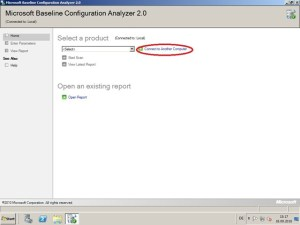
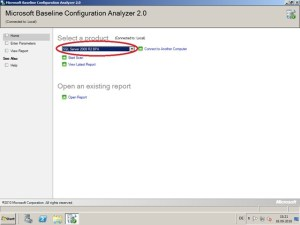
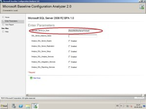

I have to apologize, because I made a little mistake in my previous post.

It is correct that the MBCA has a problem running properly when group policies are defined, BUT I was wrong with the remote scanning.

Let me explain my little “mistake”:

If you´re running the MBCA there are two ways scanning a machine.

1\. choosing ‘Connect to another Computer’ as shown here

Then you´ll probably get the error as described in the previous post (the execution policy stuff)

So, the 2nd way to go is:

Choose the SQL Server 2008 BPA from Dropdown menu and click ‘Start Scan’

In the next menu, you can define parameters for scanning as well as another computer!

So, sorry that I was wrong saying you cannot scan remote computers easily.

I will try to play around a little bit with the BPA. If I find more interesting stuff or issues, I will let you know.
